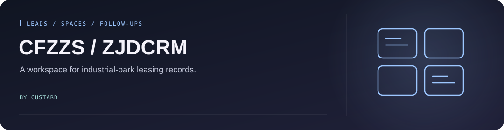

<!-- Project artwork created for this repository. -->
<p align="center">
  
</p>

<h1 align="center">CFZZS / ZJDCRM</h1>

<p align="center">
  
</p>

**A CRM for tracking industrial-park leasing leads, companies, contacts, and available spaces.**

<p align="center"><a href="#what-it-covers">What it covers</a> &nbsp; · &nbsp; <a href="#run-locally">Run locally</a> &nbsp; · &nbsp; <a href="#checks">Checks</a></p>

[Hosted app](https://cfzzs.custard.top) · [Product and architecture](docs/superpowers/specs/2026-06-21-zjdcrm-design.md)

## What it covers

- Leads, stage changes, follow-ups, and company contacts.
- Park, building, floor, and space records.
- Dashboards, imports, and controlled exports.
- User roles and access scopes.

The interface is primarily Chinese. The hosted app requires an account; there are no public demo credentials in this repository.

## Run locally

Install Node.js and npm compatible with the locked dependencies. Configure local secrets in `.dev.vars` and review the bindings in `wrangler.jsonc`.

```bash
npm ci
npm run cf:types
npx wrangler d1 migrations apply zjdcrm-db --local
npm run build
npm run pages:dev
```

Open `http://localhost:8788`. Use your deployment's configured administrator credentials.

## Checks

```bash
npm run typecheck
npm run lint
npm run test:run
npm run build
```

The [implementation notes](docs/superpowers/plans/2026-06-21-zjdcrm-implementation.md) cover the database and business workflows. Licensed under [MIT](LICENSE).
